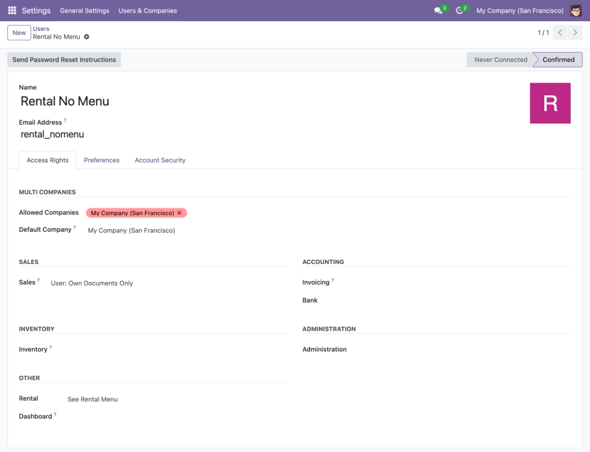
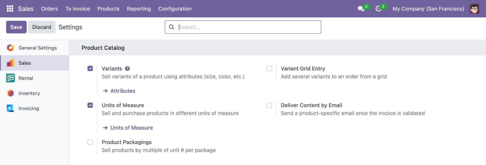
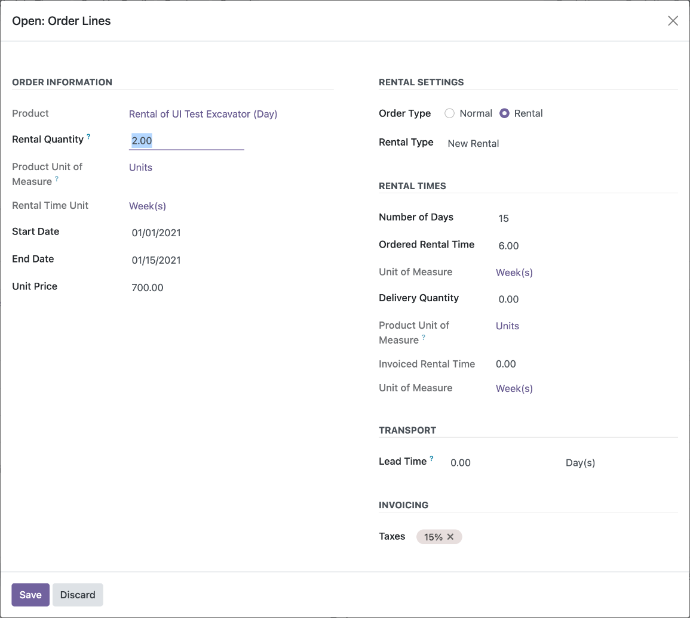
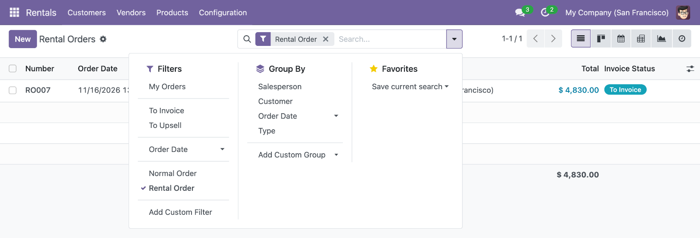

===========
Rental Base
===========

.. 
   !!!!!!!!!!!!!!!!!!!!!!!!!!!!!!!!!!!!!!!!!!!!!!!!!!!!
   !! This file is generated by oca-gen-addon-readme !!
   !! changes will be overwritten.                   !!
   !!!!!!!!!!!!!!!!!!!!!!!!!!!!!!!!!!!!!!!!!!!!!!!!!!!!
   !! source digest: sha256:3aa33913fc209f65f5d921f23e1f593e9e994d0753b589e5de2d93d567558aac
   !!!!!!!!!!!!!!!!!!!!!!!!!!!!!!!!!!!!!!!!!!!!!!!!!!!!

.. |badge1| image:: https://img.shields.io/badge/maturity-Beta-yellow.png
    :target: https://odoo-community.org/page/development-status
    :alt: Beta
.. |badge2| image:: https://img.shields.io/badge/licence-AGPL--3-blue.png
    :target: http://www.gnu.org/licenses/agpl-3.0-standalone.html
    :alt: License: AGPL-3
.. |badge3| image:: https://img.shields.io/badge/github-OCA%2Fvertical--rental-lightgray.png?logo=github
    :target: https://github.com/OCA/vertical-rental/tree/17.0/rental_base
    :alt: OCA/vertical-rental
.. |badge4| image:: https://img.shields.io/badge/weblate-Translate%20me-F47D42.png
    :target: https://translation.odoo-community.org/projects/vertical-rental-17-0/vertical-rental-17-0-rental_base
    :alt: Translate me on Weblate
.. |badge5| image:: https://img.shields.io/badge/runboat-Try%20me-875A7B.png
    :target: https://runboat.odoo-community.org/builds?repo=OCA/vertical-rental&target_branch=17.0
    :alt: Try me on Runboat

|badge1| |badge2| |badge3| |badge4| |badge5|

Base Module for Rental Management

This module provides a new menu for rental management. It is based on
the sale_rental module of this repository.

**Table of contents**

.. contents::
   :local:

Configuration
=============

Only the members of the group 'See Rental Menu' see the Rentals menu.
The superuser and the administrator get the group when the module is
installed. To give it to another user:

- Go to Settings > Users & Companies > Users.
- Open the user.
- In the tab 'Access Rights', section 'Other', set 'Rental' to 'See
  Rental Menu'.
- Save.

|See Rental Menu group|

When the module is updated to version 17.0.1.1.0 from an earlier
version, every active user with access to Sales gets the group 'See
Rental Menu'.

The field 'Rental Time Unit' of the order lines, needed to rent by week,
month or hour, is only visible with the units of measure:

- Go to Sales > Configuration > Settings.
- In the block 'Product Catalog', activate 'Units of Measure'.
- Save.

|Units of Measure setting|

Usage
=====

The Rentals menu is visible to the members of the group 'See Rental
Menu' (see the configuration section).

Create a rentable product and its rental service:

- Go to Rentals > Configuration > Settings.
- Activate the checkbox 'Variants'.
- Go to Rentals > Products > Products.
- Create a new storable product.
- Activate the checkbox 'Can be Rented'.
- Go to the tab 'Rental' and click 'Create Rental Service'.
- Set the 'Rental Service Name' and the 'Rental Price per Day'.

Create a rental order:

- Go to Rentals > Customers > Quotations > Rental Quotations.
- Create a new order and choose the 'Order Type' 'Rental Order'.
- Add the rental service as an order line. In the group 'Rental
  Settings' of the line, the option 'Rental' of 'Order Type' is
  selected; 'Normal' is for the lines that are not a rental, and
  confirming the order creates no rental for them.
- Set the 'Rental Quantity' to rent out one or several storable rentable
  products.
- Choose the 'Start Date' and the 'End Date'. The group 'Rental Times'
  shows the 'Number of Days' and the 'Ordered Rental Time'.
- Confirm the order.
- Check out the two deliveries, one for outgoing and one for incoming
  delivery.

Rent by day, week, month or hour:

- In the order line of a rental service, choose the 'Rental Time Unit':
  Days, Week(s), Month(s) or Hours.
- The 'Ordered Rental Time' is the 'Rental Quantity' multiplied by the
  number of time units from the start date to the end date, both
  included:

  - Days: one per day.
  - Week(s): every started week counts as a whole week.
  - Month(s): the number of days divided by 30.4167, the average length
    of a month, rounded to the nearest whole month.
  - Hours: for each day, the 'Average Hour per Day' of the 'Default
    Working Hours' of the company of the order, or 8 when there is none.

For example, renting 2 products from January 1 to January 15, 2021 in
Week(s) counts 3 weeks, so the 'Ordered Rental Time' is 6. In Month(s),
the same 15 days are less than half a month and count 0 months, January
1 to January 31, 2021 counts 1, and January 1 to March 1, 2021 (60 days)
counts 2.

|Rental Time Unit on an order line|

Find rental orders and sales orders:

- In the lists of quotations and orders, the search filter 'Rental
  Order' shows the orders whose 'Order Type' is 'Rental Order', and
  'Normal Order' shows all the others.
- Sales > Orders > Quotations and Sales > Orders > Orders open with the
  filter 'Normal Order' active.
- Rentals > Customers > Quotations > Rental Quotations and Rentals >
  Customers > Orders > Rental Orders open with the filter 'Rental Order'
  active.
- Remove the filter to see both kinds of orders.

|Rental Order filter|

See also the usage section of the sale_rental module.

Changelog
=========

- 8d191ff7 2022-04-10 15:41:16 +0200 wagner@elegosoft.com add
  missing/lost documentation (issue #4516)
- 39ff8efc 2022-03-14 15:15:31 +0100 cpatel@elegosoft.com [IMP]
  rental_tour correction, (issue#4516)
- ac980b89 2022-02-28 17:36:28 +0100 cpatel@elegosoft.com [FIX][IMP]
  correct code, (issue#4516)
- 4509f78a 2022-02-23 20:48:33 +0100 wagner@elegosoft.com
  (origin/feature_4516_add_files_ported_from_v12_v14,
  feature_4516_add_files_ported_from_v12_v14) add files ported to v14 by
  cpatel and khanhbui (issue #4516)

Bug Tracker
===========

Bugs are tracked on `GitHub Issues <https://github.com/OCA/vertical-rental/issues>`_.
In case of trouble, please check there if your issue has already been reported.
If you spotted it first, help us to smash it by providing a detailed and welcomed
`feedback <https://github.com/OCA/vertical-rental/issues/new?body=module:%20rental_base%0Aversion:%2017.0%0A%0A**Steps%20to%20reproduce**%0A-%20...%0A%0A**Current%20behavior**%0A%0A**Expected%20behavior**>`_.

Do not contact contributors directly about support or help with technical issues.

Credits
=======

Authors
-------

* elego Software Solutions GmbH

Contributors
------------

- elego Software Solutions GmbH
- `Binhex <http://www.binhex.cloud>`__:

  - Adasat Torres de León <a.torres@binhex.cloud>
  - Zuzanna Elzbieta Szalaty Szalaty <zuzanna@binhex.cloud>
  - Edilio Escalona Almira <e.escalona@binhex.cloud>

Maintainers
-----------

This module is maintained by the OCA.

.. image:: https://odoo-community.org/logo.png
   :alt: Odoo Community Association
   :target: https://odoo-community.org

OCA, or the Odoo Community Association, is a nonprofit organization whose
mission is to support the collaborative development of Odoo features and
promote its widespread use.

.. |maintainer-edescalona| image:: https://github.com/edescalona.png?size=40px
    :target: https://github.com/edescalona
    :alt: edescalona
.. |maintainer-szalatyzuzanna| image:: https://github.com/szalatyzuzanna.png?size=40px
    :target: https://github.com/szalatyzuzanna
    :alt: szalatyzuzanna

Current `maintainers <https://odoo-community.org/page/maintainer-role>`__:

|maintainer-edescalona| |maintainer-szalatyzuzanna| 

This module is part of the `OCA/vertical-rental <https://github.com/OCA/vertical-rental/tree/17.0/rental_base>`_ project on GitHub.

You are welcome to contribute. To learn how please visit https://odoo-community.org/page/Contribute.
