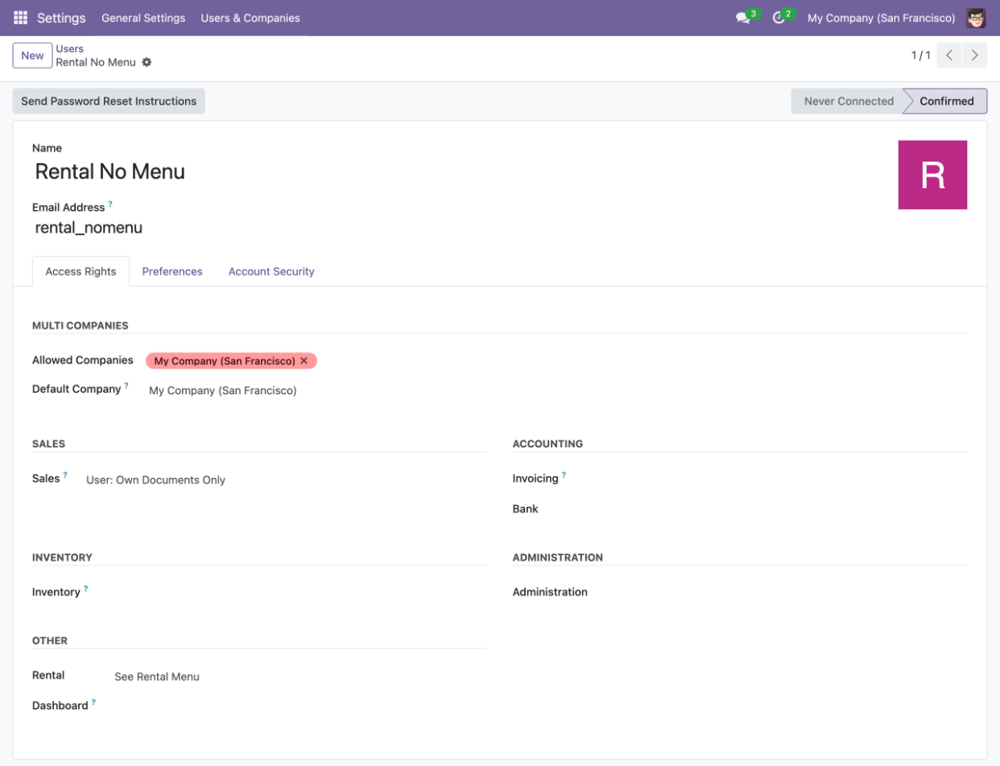
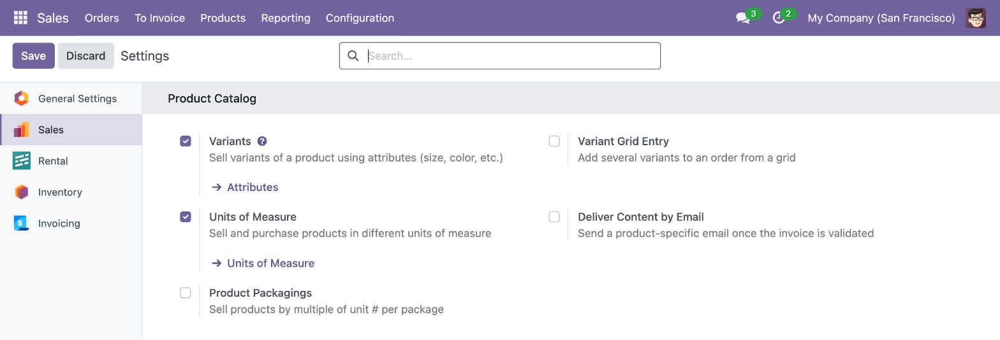

Only the members of the group 'See Rental Menu' see the Rentals menu. The superuser and
the administrator get the group when the module is installed. To give it to another
user:

- Go to Settings \> Users & Companies \> Users.
- Open the user.
- In the tab 'Access Rights', section 'Other', set 'Rental' to 'See Rental Menu'.
- Save.

When the module is updated to version 17.0.1.1.0 from an earlier version, every active
user with access to Sales gets the group 'See Rental Menu'.

The field 'Rental Time Unit' of the order lines, needed to rent by week, month or hour,
is only visible with the units of measure:

- Go to Sales \> Configuration \> Settings.
- In the block 'Product Catalog', activate 'Units of Measure'.
- Save.

