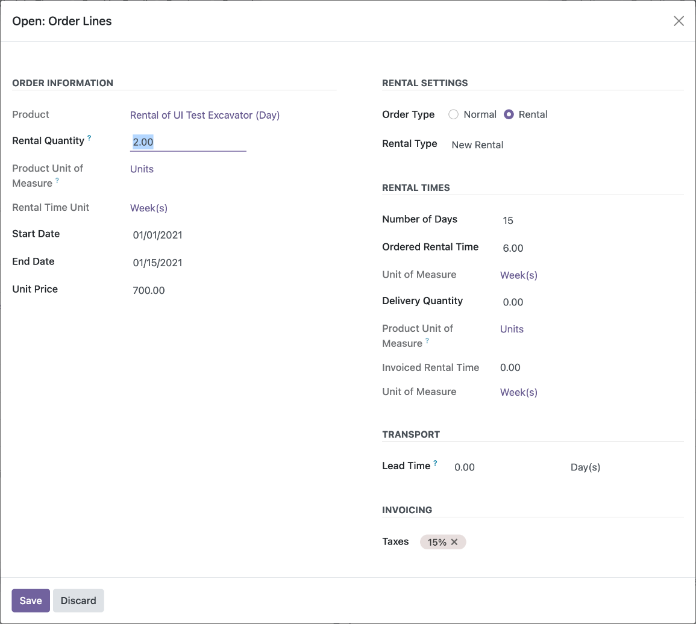
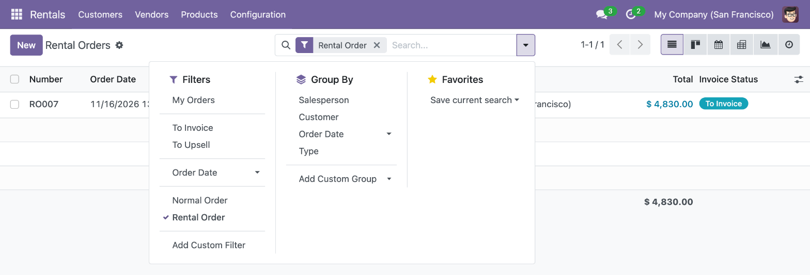

The Rentals menu is visible to the members of the group 'See Rental Menu' (see the
configuration section).

Create a rentable product and its rental service:

- Go to Rentals \> Configuration \> Settings.
- Activate the checkbox 'Variants'.
- Go to Rentals \> Products \> Products.
- Create a new storable product.
- Activate the checkbox 'Can be Rented'.
- Go to the tab 'Rental' and click 'Create Rental Service'.
- Set the 'Rental Service Name' and the 'Rental Price per Day'.

Create a rental order:

- Go to Rentals \> Customers \> Quotations \> Rental Quotations.
- Create a new order and choose the 'Order Type' 'Rental Order'.
- Add the rental service as an order line. In the group 'Rental Settings' of the line,
  the option 'Rental' of 'Order Type' is selected; 'Normal' is for the lines that are
  not a rental, and confirming the order creates no rental for them.
- Set the 'Rental Quantity' to rent out one or several storable rentable products.
- Choose the 'Start Date' and the 'End Date'. The group 'Rental Times' shows the
  'Number of Days' and the 'Ordered Rental Time'.
- Confirm the order.
- Check out the two deliveries, one for outgoing and one for incoming delivery.

Rent by day, week, month or hour:

- In the order line of a rental service, choose the 'Rental Time Unit': Days, Week(s),
  Month(s) or Hours.
- The 'Ordered Rental Time' is the 'Rental Quantity' multiplied by the number of time
  units from the start date to the end date, both included:
  - Days: one per day.
  - Week(s): every started week counts as a whole week.
  - Month(s): the number of days divided by 30.4167, the average length of a month,
    rounded to the nearest whole month.
  - Hours: for each day, the 'Average Hour per Day' of the 'Default Working Hours' of
    the company of the order, or 8 when there is none.

For example, renting 2 products from January 1 to January 15, 2021 in Week(s) counts 3
weeks, so the 'Ordered Rental Time' is 6. In Month(s), the same 15 days are less than
half a month and count 0 months, January 1 to January 31, 2021 counts 1, and January 1
to March 1, 2021 (60 days) counts 2.

Find rental orders and sales orders:

- In the lists of quotations and orders, the search filter 'Rental Order' shows the
  orders whose 'Order Type' is 'Rental Order', and 'Normal Order' shows all the others.
- Sales \> Orders \> Quotations and Sales \> Orders \> Orders open with the filter
  'Normal Order' active.
- Rentals \> Customers \> Quotations \> Rental Quotations and Rentals \> Customers \>
  Orders \> Rental Orders open with the filter 'Rental Order' active.
- Remove the filter to see both kinds of orders.

See also the usage section of the sale_rental module.
